# Platform integration handoff (.NET)

This page is for a platform's .NET team and the Seel solutions engineer working with them. The platform runs an e-commerce product, and each retailer on it is an independent store with its own Seel merchant. The platform holds one Seel API key for all of its retailers. This page walks the integration end to end, names the file and function in this repo that already does each part, and lists what the platform must build and what Seel runs. Read it top to bottom once, then work from the [build checklist](#build-checklist).

## Who owns each piece

Every node in the diagrams carries one of these tags.

| Tag | Meaning |
|---|---|
| `BUILT` | Built in this repo. The platform copies it into its own solution, adapts it, and hosts it. |
| `PLATFORM` | The platform builds it. This repo has no code for it. |
| `PLATFORM`, indigo outline | A seam. This repo ships a demo version, and the platform replaces it before go-live. There are two: `IRetailerResolver` and `HandleWebhookEvent`. |
| `SEEL` | Seel runs it. The platform calls it or receives from it. |

Solid blue arrows are HTTPS calls. Solid grey arrows are in-process calls. Dashed arrows with a filled head are returns. Dashed arrows with an open head are async events, such as a webhook.

The order lifecycle needed more messages than one sequence diagram allows, so it is split in two (diagrams 4 and 5). Each diagram also exists as an `.html` file next to its `.svg`. Open the `.html` file in a browser for the full-size version.

## 1. Who owns what

1. The shopper's browser loads `widget/seel-widget.js`, which exposes `window.SeelSDK`. The widget posts the cart to the platform's quote proxy and never holds an API key.
2. The quote proxy is `Seel.ExampleServer/ProxyHandler.cs`, entry point `ProxyHandler.HandleAsync`. It asks `IRetailerResolver` (`Seel.ExampleServer/RetailerResolver.cs`) which merchant the request belongs to. The platform replaces the demo `OriginRetailerResolver` with its own implementation.
3. The proxy and the platform backend both call Seel through `SeelClient` (`Seel.Client/SeelClient.cs`). `SeelClient` adds `X-Seel-Api-Key` and `X-Seel-Api-Version` to every request.
4. Seel sends webhooks to `POST /webhooks/seel`. `ProxyHandler.ReceiveWebhook` checks the signature with `SeelWebhooks.VerifySignature` (`Seel.Client/SeelWebhooks.cs`), answers 200, and then calls `ProxyHandler.HandleWebhookEvent`. Today `HandleWebhookEvent` only logs. The platform replaces its body to route events into its own systems.
5. The shopper reaches the Seel Resolution Center to file a claim. This repo does not reference the `resolve.seel.com` host or the confirmation-email link. Confirm both with Seel.

## 2. Enable a retailer

1. A platform admin turns the program on for a retailer in the platform's Control Panel. The platform backend builds the merchant payload and calls `SeelClient.CreateMerchantAsync`. The payload needs `shop_id`, `admin_domain`, `shop_domain`, `shop_platform`, `shop_currency`, `shop_name`, `contact_name`, `contact_email`, and `seel_services`. Each `seel_services` entry carries `type`, `is_enabled: true`, `is_default_on`, and a `coverages` key. `SeelValidation.ValidateMerchant` checks these before the request leaves.
2. Seel returns the retailer's `merchant_id`. The backend stores it against the storefront and adds the storefront origin to its resolver store. In the demo that store is the `SEEL_RETAILER_MERCHANTS` environment variable, which `MerchantBinding.ParseRetailerMerchants` (`Seel.ExampleServer/ServerConfig.cs`) reads once at startup. A platform that adds retailers while running needs a resolver backed by its own database.
3. The backend calls `SeelClient.CreateOrdersBatchAsync` with at least 30 days of the retailer's order history, so Seel can run risk analysis. The widget can then show on that storefront.
4. To turn the program off, for example when a retailer opts out or billing fails, call `SeelClient.UpdateMerchantAsync` with `is_enabled: false` and a `disabled_reason`. Set `is_enabled` back to true to re-enable. Call `SeelClient.GetMerchantAsync` to confirm what Seel holds.

## 3. Checkout quote

1. Platform checkout code calls `SeelSDK.setMerchantId(id)` with the retailer's merchant ID, then `SeelSDK.createQuote(cart, callback)`. The widget posts the cart to `/v1/ecommerce/quotes` on the proxy. `SeelSDK.configure({ quoteEndpoint })` points it at a different URL.
2. `ProxyHandler` calls `IRetailerResolver.AuthenticateCaller`. A null result answers 401. Then it calls `IRetailerResolver.ResolveMerchantId`. In table mode an unknown or missing `Origin` answers 403, and so does a body `merchant_id` that names a different merchant.
3. `ProxyHandler` stamps the resolved `merchant_id` into the body, and stamps `type` from `SEEL_QUOTE_TYPE` when it is set. It then calls `SeelClient.CreateQuoteAsync`, which sends `X-Seel-Api-Key` from the server.
4. The widget renders the quote into `#seel-wfp-widget-root` and calls the `createQuote` callback with `(quote, checkboxStatus)`, or `(null, null, { code, message })` on failure. It shows nothing when `coverages[]` is empty, because an unpriced market returns `accepted` with `price: 0.0`.
5. Register a handler with `SeelSDK.checkboxChange((quote, checked) => ...)`. It fires only when the opt-in state changes. Add the fee to the order when `checked` is true and remove it when false.
6. Call `createQuote` again when the cart, the shipping address, a discount, or the shipping method changes. The widget drops out-of-order responses and keeps the shopper's choice across re-quotes.

## 4. Order lifecycle

1. When an order is placed, the platform order pipeline calls `SeelClient.CreateOrderAsync` for every order. On opt-in, `seel_services` is an array of `{ type, price, quote_id }` from the latest quote. On opt-out, send an empty `seel_services` array, plus `extra_info.quote_id` if the program asks for it.
2. On an opt-in, `CreateOrderAsync` runs `SeelValidation.EnsureContractMinted` on the response. A 200 with `contract_id: null` throws `SeelContractNotMintedException`, and the proxy maps that to a 409. Do not retry it, because the order exists at Seel.
3. Seel sends `contract.created` to the webhook receiver.
4. When the order ships, call `SeelClient.CreateFulfillmentAsync` with tracking number and carrier. Call `SeelClient.UpdateFulfillmentAsync` when delivery status changes. This repo does not name a webhook for fulfillment.
5. When the order is cancelled, call `SeelClient.CancelOrderAsync`. Coverage cancels with it, and Seel sends `contract.cancelled`.
6. Call `SeelClient` from the order pipeline in-process, as drawn. Through the proxy in table mode, a server-to-server order call carries no `Origin` and gets a 403, until the platform's resolver maps its backend credentials to a merchant.

## 5. Claims and webhook handling

1. A claim starts in one of two places. The shopper files at the Seel Resolution Center, or the platform's own returns flow calls `SeelClient.CreateClaimAsync`. Delivery claims use `claim_type` `loss`, `damage`, `theft`, or `delay`. Return-shipping claims use `return_shipping`. On programs where the platform decides claims, it sends the decision with `SeelClient.UpdateClaimAsync`.
2. Seel sends every `contract.*` and `claim.*` event to `POST /webhooks/seel`. `ProxyHandler.ReceiveWebhook` checks the `X-Seel-Hmac-SHA256` header with `SeelWebhooks.VerifySignature`. A bad or missing signature answers 401.
3. The receiver answers 200 straight away. Seel retries anything not answered with a 200 within 10 seconds.
4. After the response is sent, `Response.OnCompleted` calls `HandleWebhookEvent`. The platform's version dedupes on the payload's `id` plus `type`, because delivery is at-least-once, and queues the work instead of doing it inline.
5. The handler routes each event to its retailer by `merchant_id`. On `contract.cancelled`, the platform backend refunds the WFP fee and its tax to the shopper. The refund must be idempotent, because the same event can arrive twice.

## Build checklist

| Step | Already built (file, function) | Platform writes | Config / env | What failure looks like |
|---|---|---|---|---|
| Host the proxy | `Seel.ExampleServer/ExampleServer.cs` `ExampleServer.Build`, `ProxyHandler.HandleAsync` | Hosting, TLS, and auth for retailer backends. Swap the `IRetailerResolver` registration in `Build`. | `SEEL_API_KEY`, `SEEL_BASE_URL`, `HOST`, `PORT` | Startup warns `SEEL_API_KEY not set`. Bodies over 1 MiB get 413. Stalled bodies get 408. |
| Enable a retailer | `SeelClient.CreateMerchantAsync`, `SeelValidation.ValidateMerchant` | Control Panel toggle, merchant payload, storage of `merchant_id` per storefront | `SEEL_API_KEY`, `SEEL_BASE_URL` | `SeelValidationException` lists missing fields before sending. Without the `coverages` key and with validation off, Seel answers 500 `system error`. |
| Backfill history | `SeelClient.CreateOrdersBatchAsync` | Export of at least 30 days of orders per retailer | None | `SeelApiException` with Seel's status, `error`, and `trace_id`. |
| Disable or re-enable | `SeelClient.UpdateMerchantAsync`, `SeelClient.GetMerchantAsync` | Opt-out and billing-failure triggers, `disabled_reason` values | None | `SeelApiException` with Seel's status. |
| Bind requests to a retailer | `IRetailerResolver`, `OriginRetailerResolver`, `MerchantBinding` | A resolver backed by the platform's storefront table, plus auth for server-to-server calls | `SEEL_RETAILER_MERCHANTS` in the demo. Never set `SEEL_MERCHANT_ID` on a platform. | 401 when `AuthenticateCaller` returns null. 403 for an unknown origin or a mismatched body `merchant_id`. Malformed JSON, or both variables set, stops startup. |
| Show the widget | `widget/seel-widget.js` `setMerchantId`, `createQuote`, `checkboxChange`, `updateCheckboxStatus`, `configure` | Checkout page wiring, the `#seel-wfp-widget-root` mount, fee line item, tax on the fee, styling to Seel's design guidelines | `quoteEndpoint` via `configure` | Callback gets `QUOTE_FAILED` or `INVALID_PAYLOAD`. No widget when `coverages[]` is empty. |
| Proxy the quote | `ProxyHandler` quote route, `SeelClient.CreateQuoteAsync`, `SeelValidation.ValidateQuote` | Cart-to-payload mapping, with `final_price = price + sales_tax - allocated_discounts` per line item | `SEEL_QUOTE_TYPE` | 400 with a `problems` array. Seel's own status for a rejected `type`. 504 after 15 seconds. 502 when Seel is unreachable. |
| Create every order | `SeelClient.CreateOrderAsync`, `SeelValidation.EnsureContractMinted` | Order pipeline hook for every order. Opt-in sends `seel_services` with `type`, `price`, and `quote_id`. Opt-out sends an empty array. | None | `SeelContractNotMintedException`, or 409 at the proxy, when no contract minted. 504 means look the order up before retrying. |
| Fulfill | `SeelClient.CreateFulfillmentAsync`, `SeelClient.UpdateFulfillmentAsync` | Shipping hook with tracking number and carrier. An order-ownership check before proxying. | None | Seel's status passed through. 400 for an id that escapes its path segment. |
| Cancel | `SeelClient.CancelOrderAsync` | Cancellation hook. An order-ownership check before proxying. | None | Seel's status passed through. If the call is skipped, Seel is never told the order was cancelled. |
| Claims | `SeelClient.CreateClaimAsync`, `SeelClient.UpdateClaimAsync` | Returns-flow hook, plus adjudication if the program assigns it to the platform | None | `SeelApiException` with Seel's status and `trace_id`. |
| Receive webhooks | `ProxyHandler.ReceiveWebhook`, `SeelWebhooks.VerifySignature` | Nothing beyond hosting the route on a public URL | `SEEL_WEBHOOK_SECRET` | 401 `invalid signature` for a wrong secret or an altered body. An empty secret fails every webhook. No webhooks at all means Seel has not registered the URL for this environment. |
| Handle webhooks | `ProxyHandler.HandleWebhookEvent` (logs only) | Dedupe on `id` plus `type`, a queue, routing by `merchant_id`, an idempotent refund of the WFP fee and its tax on `contract.cancelled` | None | Errors are logged as `[webhook] processing error` after the 200, so Seel does not retry them. A missing dedupe shows up as double refunds. |

## Go-live checklist

- [ ] Production API key set in `SEEL_API_KEY`. A sandbox key fails against production.
- [ ] Production webhook secret set in `SEEL_WEBHOOK_SECRET`. Seel issues it with the key.
- [ ] `SEEL_BASE_URL` set to `https://api.seel.com`.
- [ ] Production merchant IDs created for every enabled retailer. Merchants are created per environment, so sandbox IDs do not carry over.
- [ ] Webhook URL registered by Seel for each environment. There is no self-serve registration, so ask the Seel contact.
- [ ] Rates and market eligibility confirmed by Seel for each environment and currency.
- [ ] Origin table populated for every enabled storefront.
- [ ] `OriginRetailerResolver` replaced with the platform's `IRetailerResolver`.
- [ ] `HandleWebhookEvent` replaced with the platform's handler.
- [ ] Refunds of the WFP fee and its tax are idempotent.
- [ ] Order ownership checked before any order, fulfillment, or cancel call is proxied.
